# SolarEdge Off-Grid Monitor

Ein E-Ink-Display auf Basis eines Raspberry Pi Zero, das die Daten einer SolarEdge-Anlage auf einen Blick zeigt: Produktion, Verbrauch, Einspeisung, Netzbezug, Hausakku, Solarprognose und einen 14-Tage-Verlauf. Die Anzeige wechselt automatisch zwischen den Bildschirmen und läuft als systemd-Dienst.

## Bildschirme

| Produktion | Verbrauch |
|:---:|:---:|
| 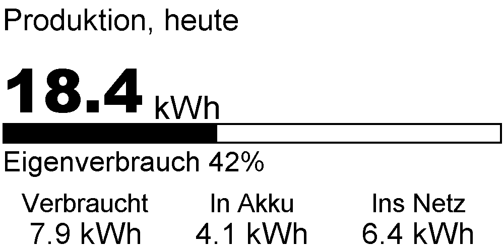 | 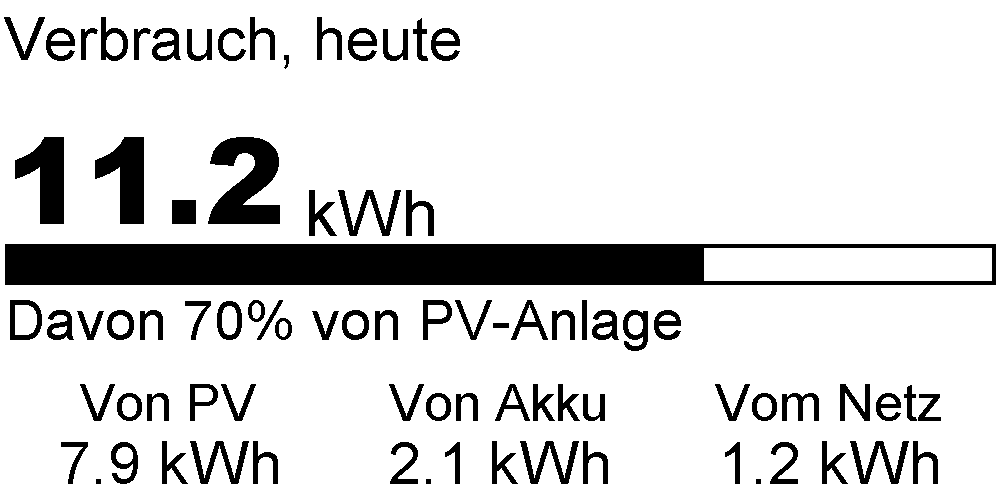 |
| **Einspeisung** | **Netzbezug** |
| 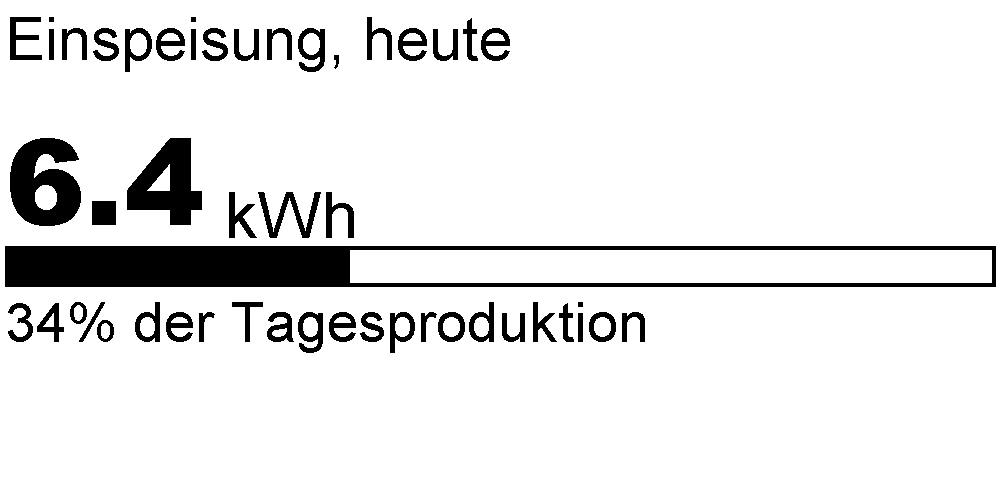 | 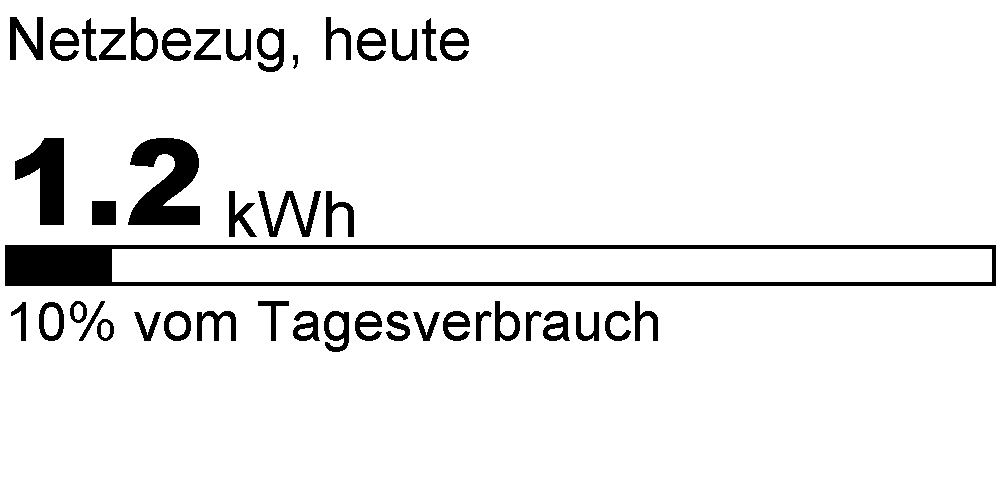 |
| **Hausakku (Laden)** | **Hausakku (Entladen)** |
| 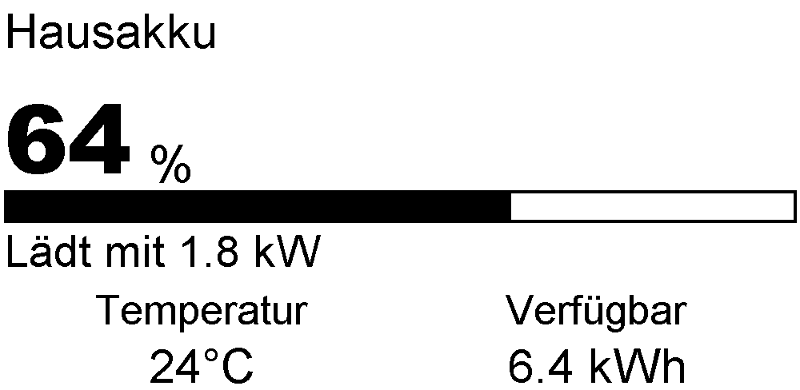 | 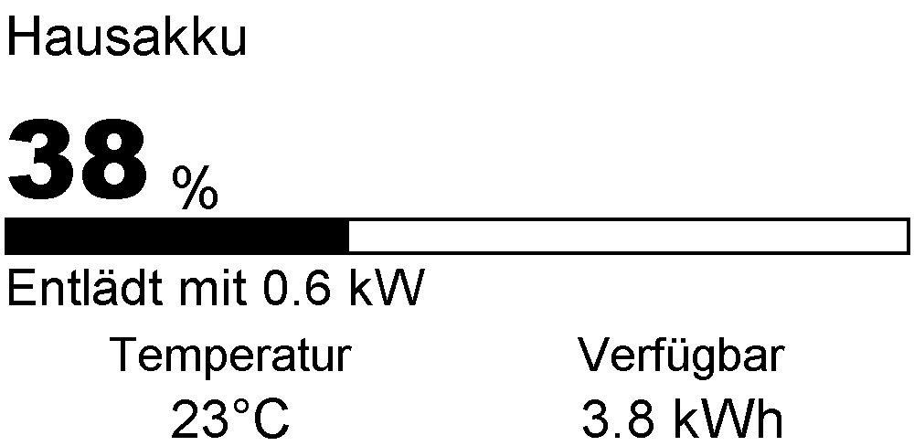 |
| **Hausakku (Ruhe)** | **Prognose** |
| 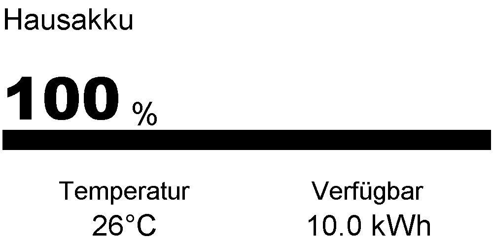 | 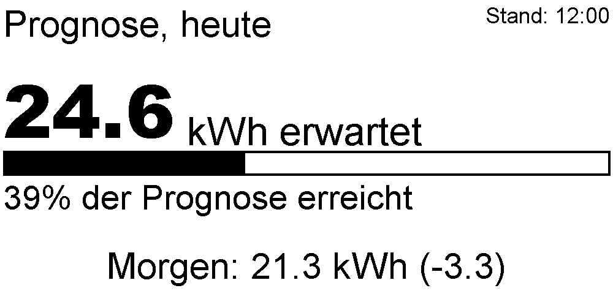 |
| **Verlauf Produktion** | **Verlauf Verbrauch** |
| 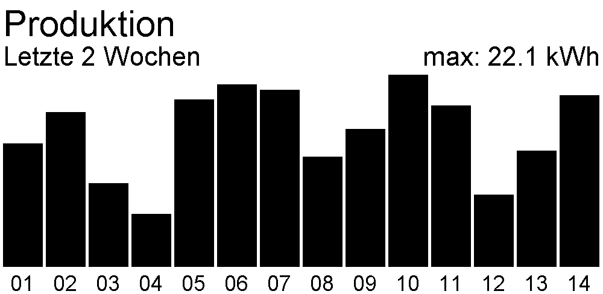 | 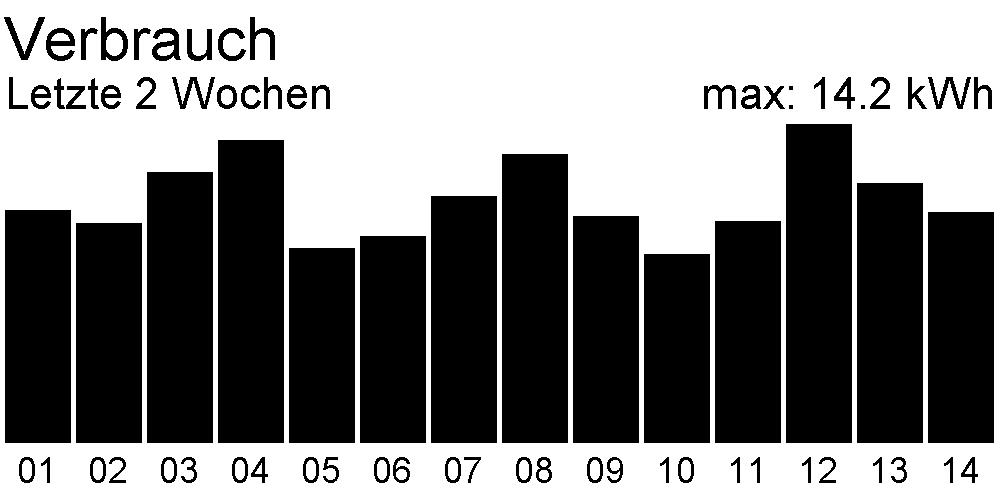 |
| **Login nötig** | **Kontingent aufgebraucht** |
| 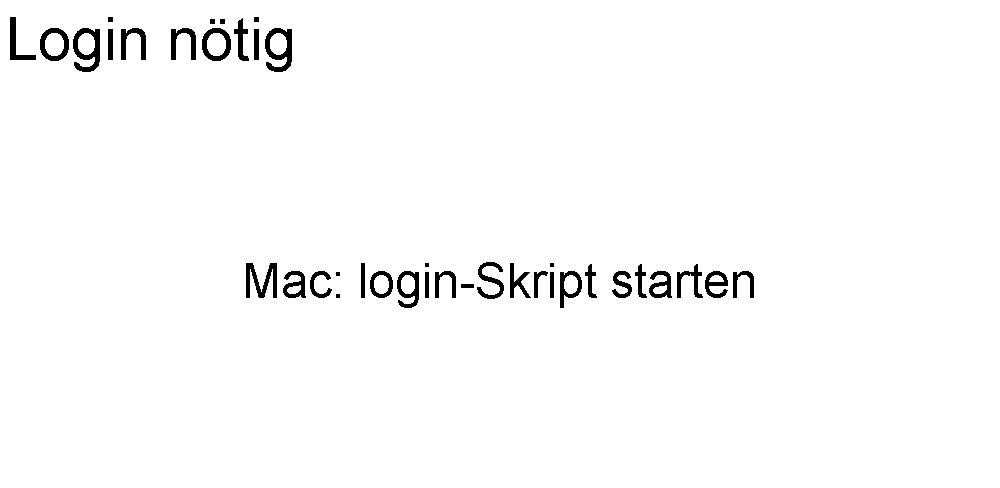 | 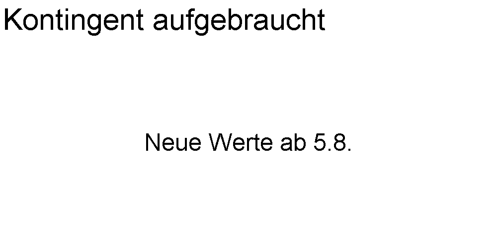 |

Die Beispielbilder entstehen offline aus erfundenen Werten (`scripts/render_doc_screens.py`). Der Hausakku-Bildschirm erscheint nur, wenn die Anlage eine Batterie hat (automatische Erkennung beim Start), der Prognose-Bildschirm nur, wenn die Prognose konfiguriert ist. Die beiden letzten Bilder sind Hinweisbildschirme: "Login nötig" ersetzt die Rotation, wenn der Zugang erneuert werden muss, "Kontingent aufgebraucht" erscheint, solange das API-Kontingent erschöpft ist.

## Hardware

| Teil | Modell |
|------|--------|
| Rechner | Raspberry Pi Zero WH (WLAN, vorgelötete Stiftleiste) |
| Display | Waveshare 2.13" e-Paper V3 (250x122, schwarz/weiß) |
| Netzteil | 5 V, mindestens 2,5 A, Micro-USB |
| Speicher | microSD-Karte, 16 GB oder mehr |

Außerdem nötig: eine SolarEdge-Anlage mit Zugang zum Monitoring-Portal (mySolarEdge). Eine Batterie ist optional.

## SolarEdge-API-Zugang

Der Monitor nutzt die SolarEdge-API V2 mit OAuth. Du brauchst dafür:

1. Ein Entwicklerkonto im SolarEdge-Monitoring und dort eine eigene OAuth-App. Als Redirect-URI trägst du `http://localhost:8765/callback` ein.
2. Client-ID und Client-Secret der App. Lege sie in einem Passwortmanager ab, zum Beispiel in einem 1Password-Eintrag "SolarEdge API". Das Login-Skript liest sie von dort.

Wichtige Eigenschaften der API:

- Das kostenlose Kontingent beträgt 2000 Aufrufe pro Monat (und 10 Aufrufe pro Minute) für das gesamte Entwicklerkonto. Jeder Aufruf kostet einen Punkt. Der Monat beginnt am Tag, an dem das Konto angelegt wurde. Diesen Tag zeigt die Entwicklerkonsole im Reiter "Usage".
- Ein Zugriffstoken gilt 2 Stunden. Das Refresh-Token wird bei jeder Erneuerung ausgetauscht und verfällt, wenn es 14 Tage lang nicht benutzt wird. Das Einverständnis selbst gilt bis zu 24 Monate.
- Nur der Pi erneuert Tokens. Eine Erneuerung auf einem anderen Rechner würde das Token des Pi ungültig machen.

## Installation

Voraussetzungen: Raspberry Pi OS Bookworm, Zugriff per SSH (`ssh <pi-host>`), der Benutzer `pi`.

```bash
git clone https://github.com/jkoenig/solaredge-monitor.git /home/pi/solaredge-monitor
cd /home/pi/solaredge-monitor
./install.sh
```

`install.sh` aktiviert SPI, legt die virtuelle Python-Umgebung an, installiert die Abhängigkeiten, erzeugt `.env` aus `.env.example` und installiert die systemd-Unit. Nicht als root ausführen. Danach:

1. `.env` anpassen (`nano .env`); alle Optionen sind in `.env.example` erklärt. Client-ID und Secret schreibt später das Login-Skript.
2. Den Pi neu starten, falls das Skript es verlangt (SPI- und Gruppenrechte).
3. Prüfen, dass die Zeitsynchronisation aktiv ist: `timedatectl show -p NTPSynchronized` muss `yes` liefern. Der Pi Zero hat keine Echtzeituhr; der Dienst wartet beim Start auf `time-sync.target`, damit die Zeitfenster der API-Aufrufe stimmen.
4. Das Login durchführen (nächster Abschnitt), dann startet der Dienst die Anzeige.

## Login-Skript

`scripts/solaredge_login.py` läuft auf dem Mac (oder einem anderen Rechner mit Browser), nicht auf dem Pi. Es nutzt nur die Python-Standardbibliothek und braucht die Programme `op` (1Password-Kommandozeile), `ssh` und `scp`.

Einrichtung:

```bash
cp scripts/solaredge_login.example.ini scripts/solaredge_login.local.ini
```

`solaredge_login.local.ini` wird von git ignoriert. Trage dort `host` (Adresse des Pi, zum Beispiel `<pi-host>`), `remote_dir`, `op_item` (Name oder ID des Passwortmanager-Eintrags) und bei mehreren Konten `op_account` ein.

Login:

```bash
python3 scripts/solaredge_login.py
```

Das Skript liest Client-ID und Secret aus 1Password, schreibt sie in die `.env` des Pi, öffnet die SolarEdge-Zustimmungsseite im Browser, tauscht den zurückgelieferten Code sofort gegen Tokens und lädt die Token-Datei auf den Pi hoch. Alle lokalen Kopien werden danach gelöscht. Mit `--secrets-only` werden nur Client-ID und Secret in die `.env` geschrieben. Der Mac erneuert nie Tokens, das übernimmt allein der Pi.

## Re-Login nach mehr als 14 Tagen offline

Ist der Pi länger als 14 Tage ausgeschaltet oder ohne Netz, verfällt das Refresh-Token. Der Monitor zeigt dann den Bildschirm "Login nötig" und macht keine weiteren Aufrufe. Abhilfe: auf dem Mac erneut `python3 scripts/solaredge_login.py` ausführen. Der Dienst erkennt die neue Token-Datei selbst und nimmt die Anzeige ohne Neustart wieder auf.

## API-Kontingent und Zähler

Weil jeder Aufruf Kontingent kostet, zählt der Monitor mit. Der Zähler liegt in `.calls.json` neben der Token-Datei und richtet sich nach `SOLAREDGE_BILLING_DAY`, dem Tag im Monat, an dem das SolarEdge-Kontingent zurückgesetzt wird (Default 5).

- Ab 1500 Aufrufen im Zyklus greift eine weiche Bremse: nur noch unverzichtbare Aufrufe.
- Bei 1800 Aufrufen stoppt der Monitor alle Aufrufe bis zum Zyklusende und zeigt "Kontingent aufgebraucht" mit dem Datum der nächsten Werte.
- Meldet SolarEdge selbst, dass das Monatskontingent aufgebraucht ist (Antwort 429), stoppt der Monitor sofort, auch wenn der eigene Zähler tiefer steht. Dasselbe gilt als Absicherung, wenn mindestens sechs Aufrufe hintereinander und über mindestens eine Stunde mit 429 abgelehnt werden, ohne dass der Grund erkennbar ist. War ein solcher Stopp ein Fehlalarm, hebt ihn das Seed-Skript wieder auf: Dienst stoppen, `venv/bin/python3 scripts/seed_call_counter.py --count <aktueller Stand> --force` als Benutzer `pi` ausführen, Dienst starten.

Einmal täglich schreibt der Dienst eine Zusammenfassung ins Journal, zum Beispiel:

```
Calls YYYY-MM-DD: 41 (overview 26, storage 12, history 1, token 2); cycle 530/1800
```

### Zähler setzen

Bei einer Neuinstallation, oder wenn der Dienst schon ohne Zähler lief, setzt du den Zähler einmalig auf den tatsächlichen Verbrauch. Als der Benutzer, der den Dienst betreibt, niemals mit `sudo` (sonst gehört die Sperrdatei root und der Dienst startet nicht mehr):

```bash
sudo systemctl stop solaredge-monitor
journalctl -u solaredge-monitor --since "YYYY-MM-DD 00:00" -o cat \
  | venv/bin/python3 scripts/seed_call_counter.py --from-journal --margin 20
sudo systemctl start solaredge-monitor
```

`YYYY-MM-DD` ist der erste Tag, an dem der Dienst lief, oder der Beginn des aktuellen Abrechnungszyklus, falls der später liegt. `--margin 20` addiert einen Sicherheitsaufschlag für Aufrufe außerhalb des Dienstes. Mit einer bekannten Zahl geht es auch ohne Journal: `scripts/seed_call_counter.py --count 300 --margin 20`.

Exit-Codes von `seed_call_counter.py`:

| Code | Bedeutung |
|------|-----------|
| 0 | Zähler gesetzt |
| 1 | Zählerdatei konnte nicht geschrieben werden |
| 2 | Ungültige Eingabe (negative Zahl, Abrechnungstag außerhalb 1-31) |
| 3 | Der Dienst läuft noch und hält die Sperre; erst stoppen |
| 4 | Die Sperrdatei lässt sich nicht öffnen (zum Beispiel gehört sie root) |

Ein bereits höherer Zählerstand wird nicht gesenkt, außer mit `--force`.

## Fehlerbehebung

**Bildschirm "Login nötig":** Das Token ist unbrauchbar, meist nach mehr als 14 Tagen Pause. Siehe "Re-Login nach mehr als 14 Tagen offline".

**Bildschirm "Kontingent aufgebraucht":** Das Monatskontingent ist verbraucht oder der Zähler hat die Grenze erreicht. Die Anzeige bleibt bis zum angezeigten Datum so. Prüfe in der Entwicklerkonsole den tatsächlichen Verbrauch und gleiche bei Abweichung den Zähler an (siehe "Zähler setzen").

**Display bleibt nach dem Booten leer:** Gewollt, solange die Uhrzeit nicht synchronisiert ist; der Dienst wartet auf `time-sync.target`. Prüfe das Netzwerk, `systemctl list-jobs` und `timedatectl`.

**Dienst startet nicht:** `sudo journalctl -u solaredge-monitor -n 50` zeigt den Grund. Häufige Ursache: eine Sperrdatei `.calls.json.lock`, die root gehört, weil das Seed-Skript mit `sudo` lief. Mit `sudo chown pi:pi .calls.json.lock` beheben.

**"Permission denied" auf SPI:** Benutzer in die Gruppen `spi` und `gpio` aufnehmen (`sudo usermod -a -G spi,gpio pi`) und neu starten.

**Logs ansehen:**

```bash
journalctl -u solaredge-monitor -f
```

## Deployment

Updates spielst du auf dem Pi als Benutzer `pi` ein, nicht als root:

```bash
ssh <pi-host>
cd /home/pi/solaredge-monitor
./deploy.sh
```

`./deploy.sh` holt den neuen Code per `git pull`, aktualisiert die Abhängigkeiten, installiert die systemd-Unit, falls sie sich geändert hat, und startet den Dienst neu. Läuft der Dienst danach nicht, zeigt das Skript den Status und endet mit einem Fehler.

## Entwicklung ohne Hardware

```bash
pip install -r requirements.txt
cp .env.example .env
SOLAREDGE_DEBUG=true python3 main.py
```

Im Debug-Modus landen die Bilder im Ordner `debug/`. Die Tests laufen mit `python -m unittest discover -s tests`. Die Beispielbilder für dieses README erzeugst du mit `python scripts/render_doc_screens.py`.

## Lizenz

MIT
